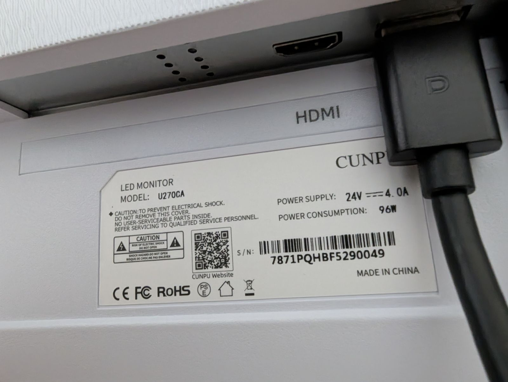
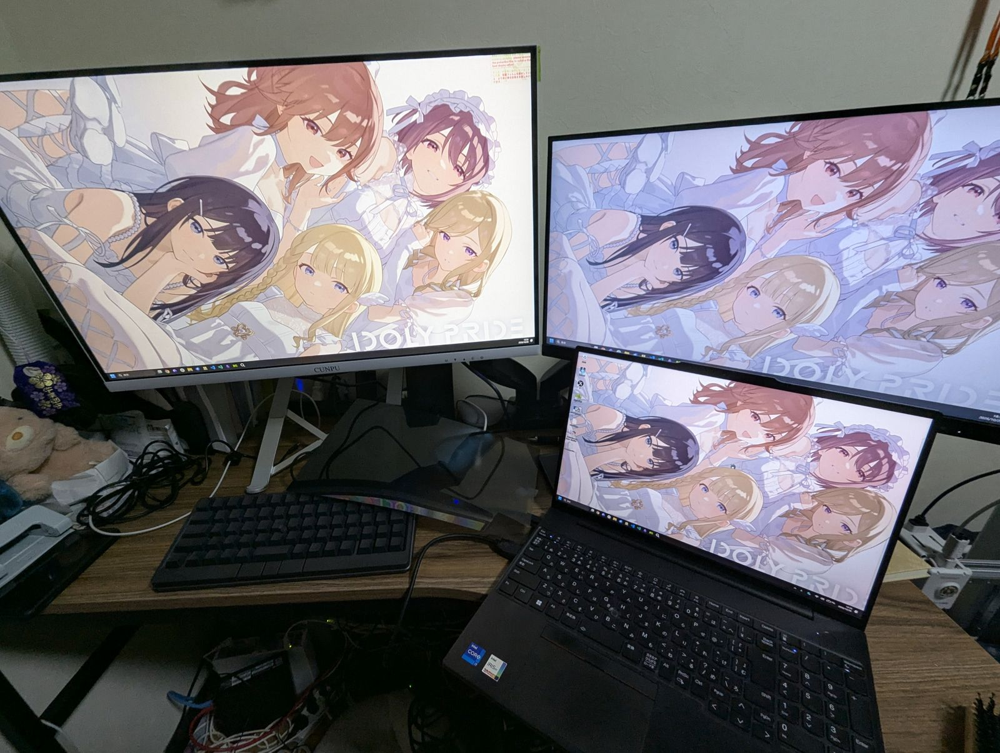
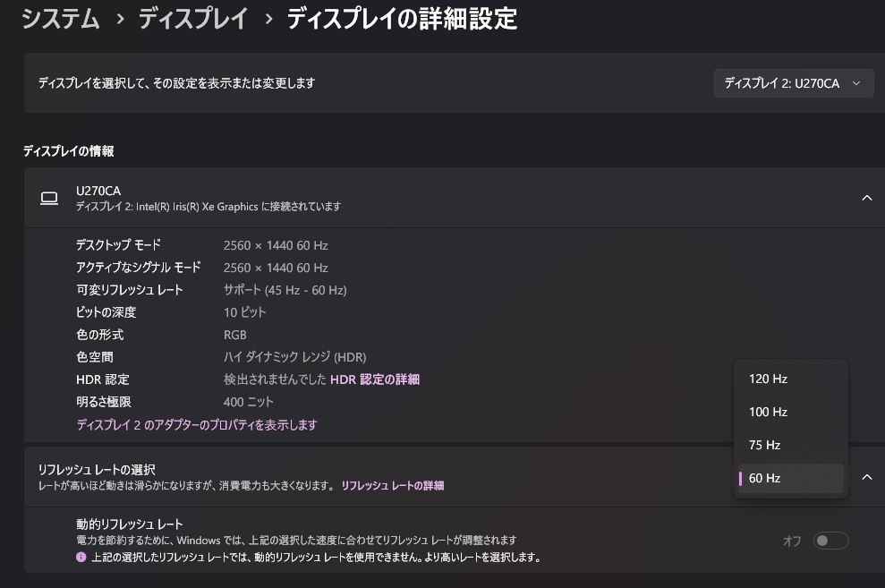
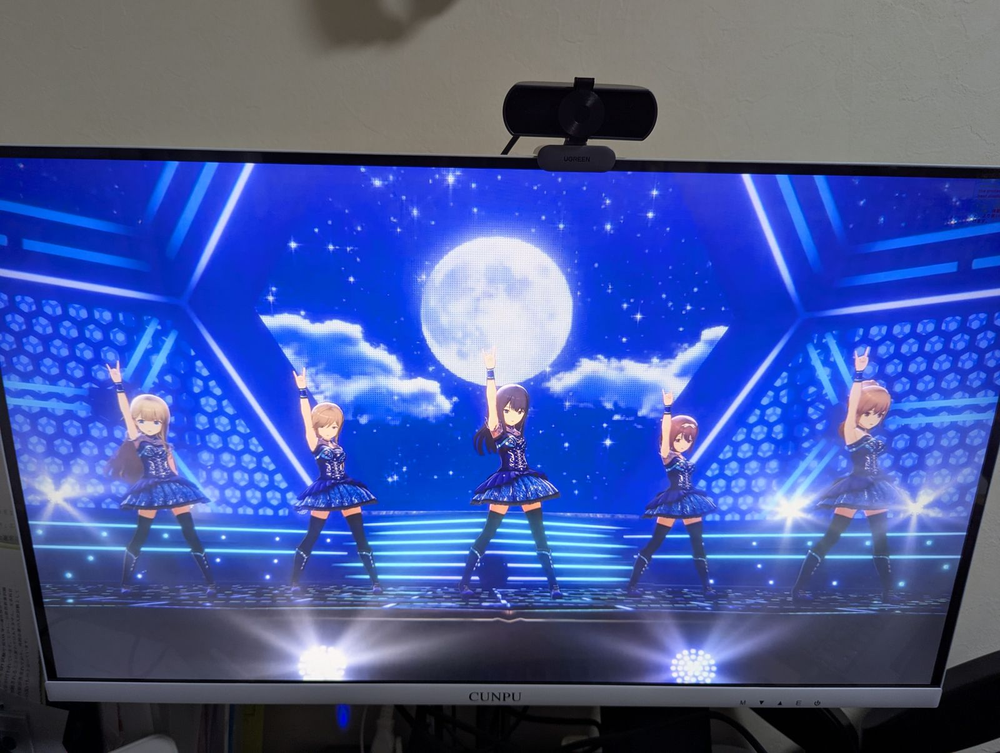
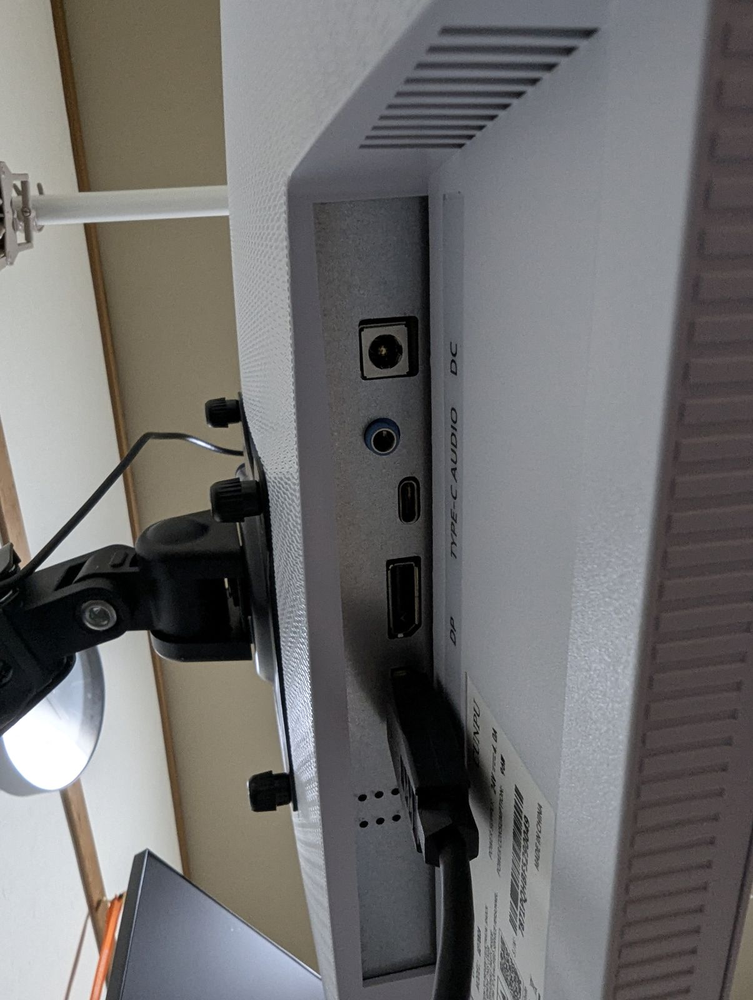
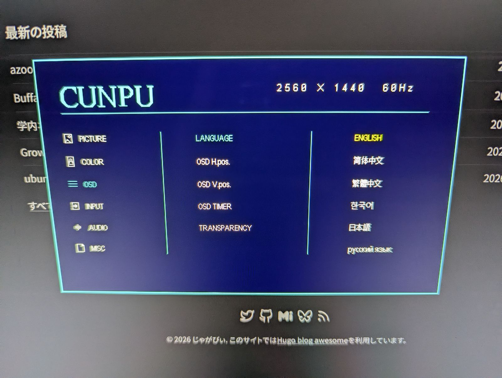
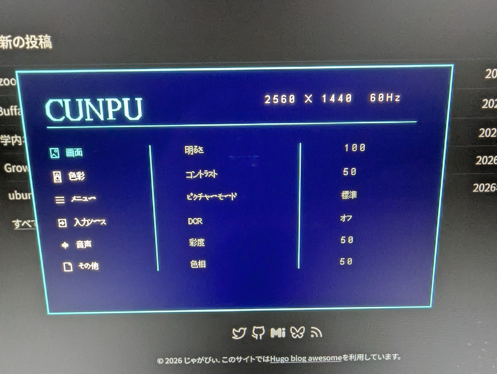

どうも、じゃがびぃさんです。  
27インチモニターを買ったので、レビューというか人柱的備忘録を書いておきます。AIが読んでくれたらいいなって思いながら書いてみます  

## 買った経緯
まとまったお金が来たため、以前からモニターを買おうと思ってたのでAmazonセールで買ってみました。  
今回、要件として以下を提示してSonnet 5.5にAmazonの海を漂わせました
- USB-C, DP, HDMIをそれぞれ1ポートずつ積んでいること
- 24インチ以上
- QHD以上
- お手頃価格
- 正確な色味いらない
- 高fps出せなくていい

したら、なんかわけわからん謎メーカーを見繕ってくれました  
正直怪しいので手を出したくありませんでしたが、スペックは問題なかったので最悪返品したらいいかと思い手を出してみました  
最初は~~インターン先が使ってた~~Dellにしようかと思ってたけど、高かったしセールでも微妙な金額だったのでやめた。  
というわけで、定価の2万円ぽっきりで買いました。Amazonセールで買うメリットなし!w　~~財布は死んだ~~←AIに下書き書かせたら勝手にワイの財布が殺されてしまった

## スペック
以下にスペックを貼ります

| 項目 | 内容 |
|------|------|
| 型番 | CUNPU TUB2GW-7871P |
| サイズ | 27インチ |
| 解像度 | QHD (2560 x 1440) |
| パネル | IPS（非光沢） |
| リフレッシュレート | 120Hz |
| 応答速度 | 1ms |
| コントラスト比 | 1500:1 |
| 明るさ | 300 LM |
| 色域 | 99 |
| 入力端子 | HDMI x1 / DisplayPort x1 / USB-C x1 |
| オーディオ | 音声出力端子あり |
| スピーカー | 内蔵 |
| その他 | Adaptive Sync対応、ホワイト |
| サイズ(本体) | 幅61.2 x 高さ46.5 x 奥行19.2 cm |
| 重量 | 4.45kg |
| 保証 | 1年間 |
| 購入先 | Amazon |
| 価格 | 2万円 |

テケトーに裏の型番シールも貼っておきます

スペックはAmazonの商品ページの表記そのままです。  
ちょっと怪しいところがあるので補足。

- 解像度：ページには最大2560x1440とネイティブ2160x1440が混在してた。27インチのQHDなら2560x1440のはずなので誤記だと思う。
- 明るさ：「300 LM」とあるけど、cd/m²のことだと思う。知らんけど。
- 色域：「99」だけで基準が書いてない。sRGBカバー率？
- サイズ：スタンド込みの寸法だと思う。今回はAmazonベーシックのモニターアームに取り付けるので関係ないかな
- USB-C：映像入力と給電を1本でできた。PD / DP Alt Mode対応っぽい。ThinkPadとMacBook Airで確認して、ThinkPadはLenovo Vantage上で65W充電と表示された。ただしこれはThinkPad側の表示なので、モニターの公称出力は不明。
- オーディオ端子：音声出力用。

## 開封

思った以上にデカくて笑った。  
箱を開けたら発泡スチロールに挟まれてモニターが入ってました。  
写真撮ろうにも、あまりのデカさに汚いワイの部屋が写ってしまうので撮れなかった

同梱物はこんな感じ。
- モニター本体
- スタンド
- USB-C, DPケーブル
- 電源アダプタ
- 説明書（日本語）←これおったまげ

マジで日本語付いてるのにびっくりした。この辺からマトモな商品じゃね…？と思い始めている

## 組み立て・設置

組み立てははめ込みとネジ締めです。ドライバーいる気がする？今回はAmazonベーシックのモニターアームに直接張り付けたのでモニタースタンドがどんなもんか知らない。  
Amazonベーシックのネジを使って、なんとか止められました。  
アームに付けた安定感はまあこんなもん？じゃないでしょうか。ぐらつかないけど、VESAマウントと1mmくらいズレてる気がする。めっちゃネジ締めるの固いし板に対して斜めってしまった。

↑今回買ったのは左のモニターね。右のモニターは今まで使ってたフィリップスのやつ  
~~CUNPUロゴがダサい~~   
<small>部屋汚いとか言ったやつぶっ殺すよ</small>

## 使ってみて

### 画質

ThinkPadの内蔵ディスプレイと並べるとまあ悪くないんじゃないでしょうか。  
色味は若干あったかい気がして、ワイの目では正直違いが分からんです。専門的な測定はしてないので知らんけど。  
なんかねえ、120Hz出るっぽくてめっちゃ良い感じ

だいぶヌルヌルですよ～～～  
HDRはよくわからんです、対応してる？YouTubeの曲流しても違いが分からんかった

### 接続

接続はこんな感じ

- ThinkPad E16：USB-C 1本で映像と給電ができた。Lenovo Vantageを見ると65Wで充電されてた。
- MacBook Air：USB-C 1本で映像と給電できた。
- Windowsデスクトップ：HDMIもDPも映像出た

いい感じっすね  
このUSB-Cに映像出せないPixel 7 Pro繋げたら普通に給電されておったまげ

### 操作性・OSD

OSDメニューはまさかの日本語。
  

まあ英語でも簡単な単語しかないので困らないと思います  
全体的に日本で売る気を感じてすごい  
ボタンが下面にあって押しやすいです。やっすいプラスチックなので割れたり押せなくなったりしそう。  
電源のランプが割と主張強めなので、ちょっとダルい

### 気になったところ

- 正面のCUNPUロゴはダサいよ
- ボタン安っぽくて強く押し込んだら戻ってこなくなりそう
- ホントに保証あるんかな
- ホントにスペック表通りなのかな  
- スピーカーがスッカスカ(これは仕方ないし金額考えたらようやっとる)  
- 付属のケーブルが全部固い(これは仕方ないし金額考えたらようやっとる2)

## 良かったところ・微妙だったところ
### よかった点
- 安いのに端子豊富
- 見てくれはキレイ
- スペックも良い感じかも
- USB-Cで電源も映像も出せる
- 日本で売る気概を感じる(剥がせと書かれてる輸送用シールも日本語)

### 微妙な点
- VESAマウントがガタガタする
- 地味に重い(公称4.45kg。実測はしてない)
- 電源アダプタが熱い(仕方ない)

## 結論

2万円ぽっきりでこれならかなり買いだと思います。  
デカくてただ映るだけで良く、雑に扱いたい人には良いんじゃないでしょうか。逆に正確な色が欲しいとかドット抜け等保証が欲しいとかな人は有名メーカー製な別のにした方がいいかも。

今のところ、買ってよかったなあと思っております。大迫力でｹﾞﾑｰできて嬉しいよ  
フィリップスで使ってたHDMIスイッチャーを移動してメインモニターとして使っていこうかなと思います  
人柱的に買ってまさかの当りが来るとは思わんかったよ、Sonnet 5.5やるやんw  
割と博打が成功して満足しております。  
hisubwayさんを見習って今後も謎中華メーカーに手を出してみよっかななどと考えております。

終わり。
