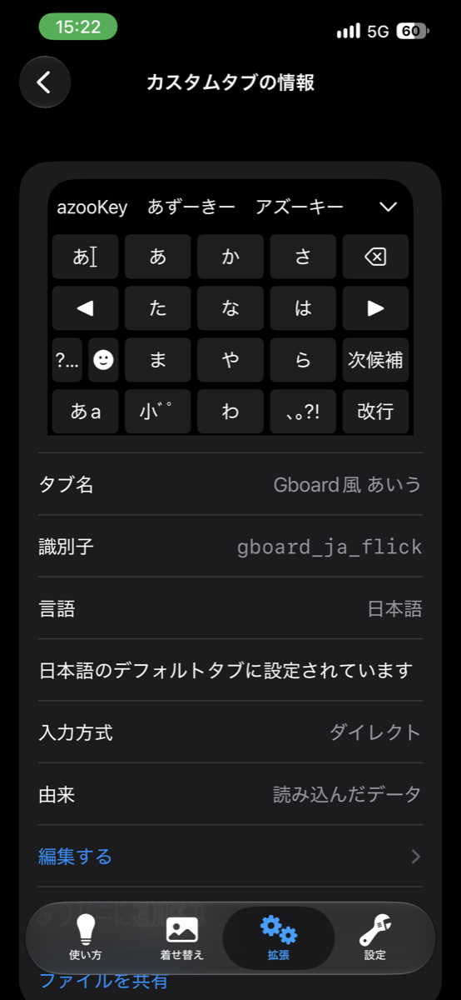
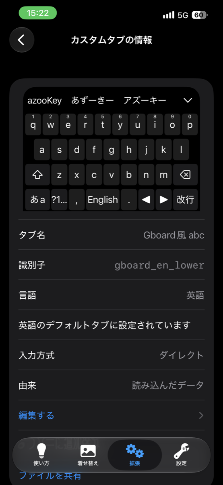

iPhoneのソフトウェアキーボードさあ、打ちづらくないですか。  
ワイがあまりにもGboardに慣れすぎただけかもしれない。どっちにしろ、使ってられんです。  
今までiPhoneは触ってこなかったが、iPhone12miniやら14無印やら買ってしまったため、使わざるを得なくなりました。  
そこで立ちはだかるキー配置に慣れるという非常に高い壁。  
本当に辛かったので、Gboardの配置を再現しようとClaudeのトークンを燃やしました。

## 作ったもの

JSONが4つ。  
例↓

  <figure>
    
    <figcaption>日本語</figcaption>
  </figure>
  <figure>
    
    <figcaption>英語</figcaption>
  </figure>

こんな感じ。  
ほぼほぼGboardと操作感変わらんと思います

| ファイル | 役割 | 
|---|---|
| gboard_ja_flick.json | [日本語フリック](https://mk.tenpest-moon.uk/files/e2f99341-de1c-4ead-9a3c-2345afbbcc22) |
| gboard_en_lower.json | [英語 小文字](https://mk.tenpest-moon.uk/files/710a06a4-2bb3-4992-8d33-ac44fc4810fc) |
| gboard_en_upper.json | [英語 大文字(一文字だけ)](https://mk.tenpest-moon.uk/files/cd7ad757-7fab-43ab-b6d6-b78ecf0d76f9) |
| gboard_en_caps.json | [英語 大文字(固定)](https://mk.tenpest-moon.uk/files/21ad54f9-29a7-471f-8814-782a022809e9) |

タブ同士が互いに移動し合う作りなので、**4つ全部入れないと動かない** by sonnet 5.5

## 入れ方

1. 4つのJSONは共有リンクでインスコできます。役割のリンクをコピー
2. azooKeyの設定 → カスタムタブの管理 → 右上+ → URLから読み込む → 貼り付け
3. 4ファイルを読み込む(順番は自由)
4. 日本語の標準タブを `gboard_ja_flick` に変更
5. 英語の標準タブを `gboard_en_lower` に変更

これで終わり。claude sonnet5.5サマサマですわ。ガチありがてえ〜〜〜

## 挙動
基本、Gboardと一緒です。
- 「あa」で日本語と英語を行き来
- shiftで大文字、長押しでCAPS←ダブルクリックがなかったらしい
- 大文字は一文字打つと自動で小文字に戻る(ワンショットシフト)
- 英語の1行目は上フリックで数字

これほぼほぼ一発目で出してきたんだよ、すごいよねえ
## いじりたいとき

- 記号を変えたい → カンマ/ピリオドキーの `variations` を編集(lower・upper・capsで揃える)
- 位置を変えたい → `specifier` の x, y を変更
- 編集後は4つとも再インポート。identifierが同じなら上書きされる

JSONは1行にまとまっているので、エディタで整形してから触るのがおすすめ。決してiPhoneからサクッと編集しようと思ってはいけない。見づらすぎる  
ファイル名やidentifierを変えるなら、`move_tab` の参照先もぜんぶ直すこと by sonnet 5.5

いや〜〜〜良い時代になったもんですね、1人1AIですわ  
これでもうiPhone使っててもキーボード配置に悩まされたり挙動に慣れる必要がなくなってハッピーハッピー。  

どんだけの人が使うか知らんが備忘録として残しておきました。

終わり。