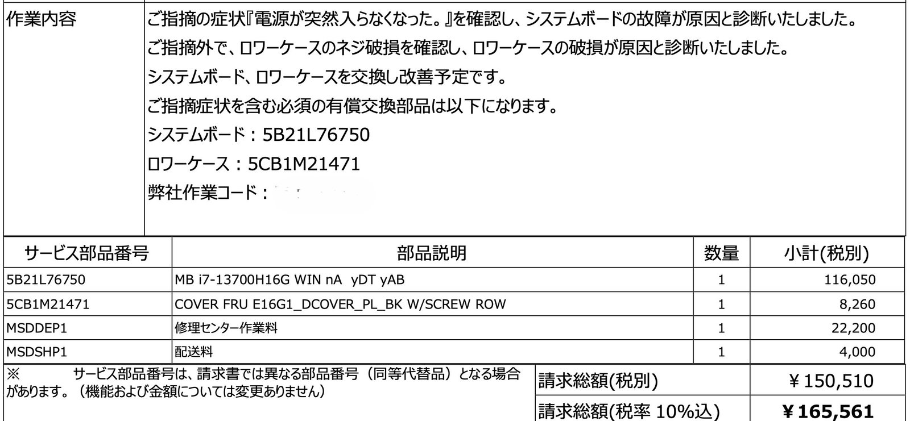
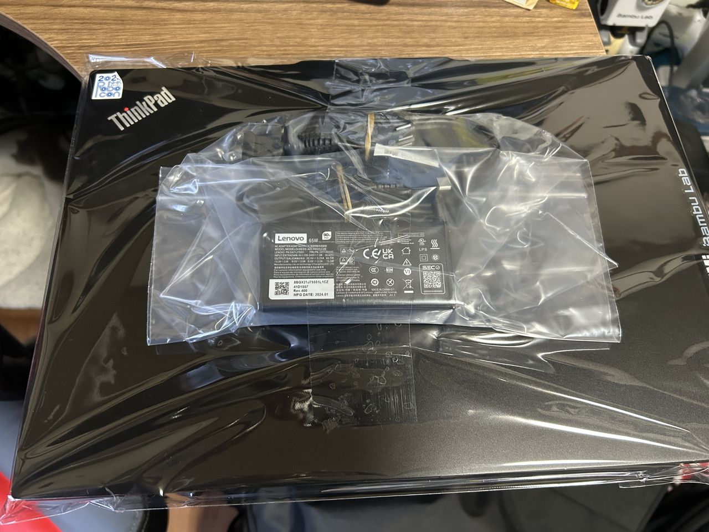
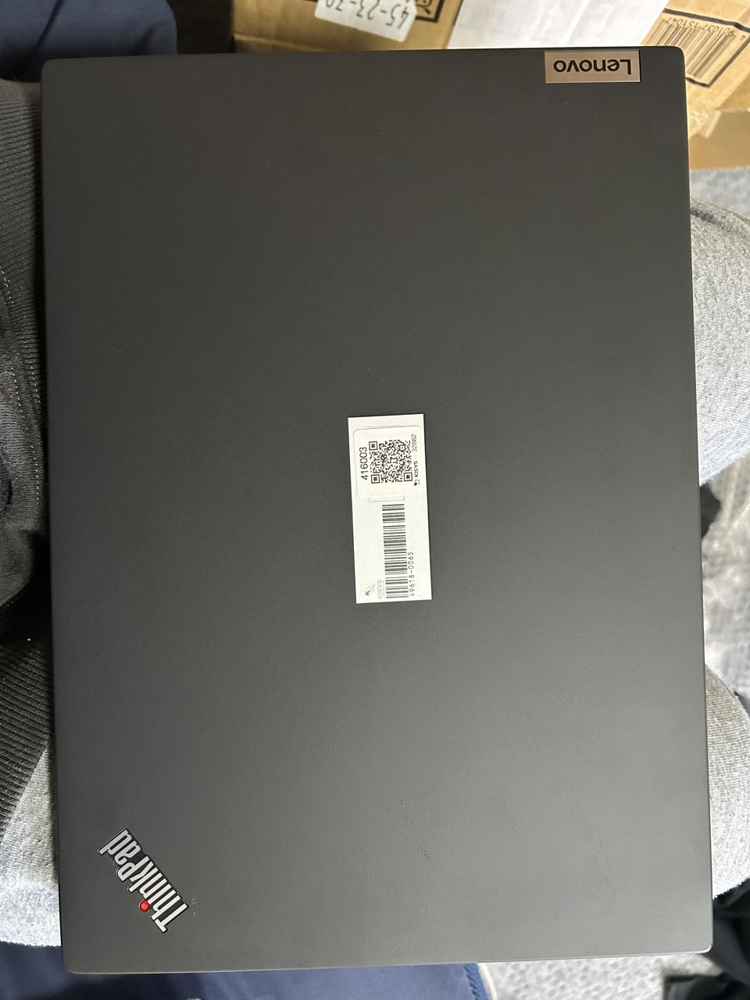
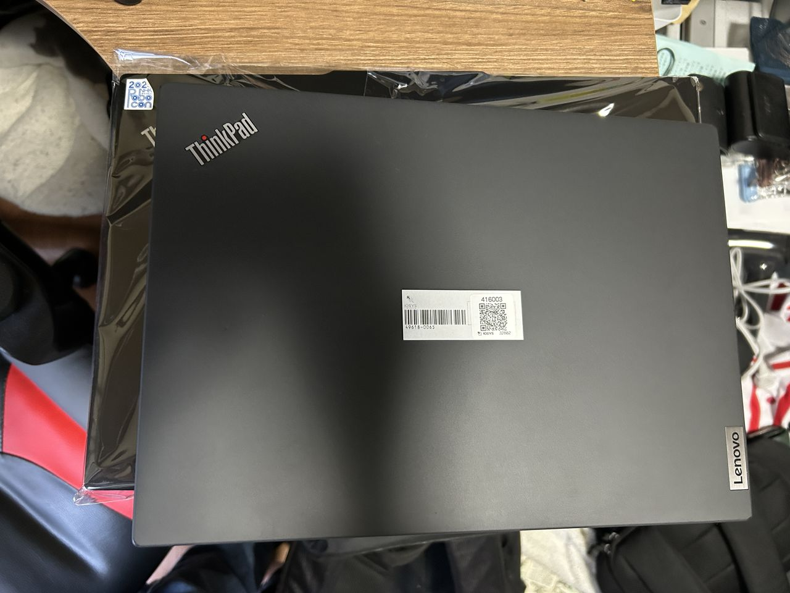

## 週報
グエー1週間終わったやんね  
パソが返ってきて新しいの買った話しよかな


## 思うこと  
ちょうど修理依頼投げた1週間後に見積もりが返ってきました  


手数料送料込みで16万だそうで。  
いや〜〜〜やっぱこれくらいするよねえ。  
ワイが2年前に買った時は、14万で本体とキャリングケース込みだったのでさすがに物価高を感じる。

焦ってもいでしまったネジ受け、修理となると裏蓋交換で1万するとは思わんかったです。  
やっぱアルミ？マグネシウム？の加工って難しいんですかね？分からんです。

本当に悩みました  
あと1年半使う型落ちに16万払うのか、1万で返してもらって新しいの買うか

正直直したかったです。思い入れあるんで。  
でも、14万で買った理由は安くで推奨pcより高スペックなのが欲しかったからなので、修理したら買った理由が消え失せるなと思いました。  
よって、修理するのを諦めることにしました。

おかえり。  


ということで、代替機を探すことにしました

最初、lenovoの新品見てみたけどやっぱり高い。  
コスパが悪いので中古にしようとmuseにイオシスを見てもらいました。  
要件として、
- ThinkPadであること
- i7-13700Hに近いスペックになること
- メモリ16GB以上
- nvme ssd刺せること、できれば2スロットあるといいな
を渡しました。  

すると、museからThinkPad X13 Gen2がいいんじゃね？って言われました。  
museのリンクガン無視して自分でググったら、同じ名前のが2つ出てきておったまげ。
museが最初に投げてきたリンクはsim刺さらないタイプで、もう1件は画像がないやつで、同じ金額やったんですよね  
何が違うんだろうって思ってスペック見たら、sim刺さるかどうかっぽい？  
スペックは以下の通り
```
ThinkPad X13 Gen2  
45,800円（税込）

スペック表
CPU	Ryzen 5 Pro 5650U 2.3GHz
メモリ	16GB
SSD	256GB
ドライブ	非搭載
ディスプレイ	13.3インチ(1920x1200)
通信	LAN(非搭載)/Wi-Fi:(a/b/g/n/ac/ax)
USB	Type-C(3.2 Gen2)x2/Type-A(3.2 Gen1)x2
その他	Webカメラ/Bluetooth5.2/HDMI/顔認証/指紋認証/nanoSIMカードスロット
OS	Windows11 Pro(64bit/インストール済)
```
5万前後なのに、cpu性能が割と近い(マルチ？シングル？は半分)こと、16GBなのでギリギリ使えそうなスペックしてますよね  
nanoSIM刺さるやんね、おもろいね。なんかお得感あるじゃないですか  
学内ネットのプロキシ回避に毎回テザリングするのめんどくせーなと思ってたので、sim挿したら楽では？？？？？？？という気持ちになった。

sim刺せるということだけに買っていいのか？？？となり、色々と調査させました。したら、ちょっとデメリットがありそうな雰囲気を感じ始める。
- ssdは2280スロット1つのみ
- バッテリーがヘタってるかも
    - 47Wh, 56Whのどっちが届くかわからない
- cpuの消費電力が15Wで、13700Hの45W(最大115W)より低いので、今までみたいにぶん回らないかも

ssdが2スロット挿せないということは、ubuntuのデュアルブート環境を持ち運べないということを意味します。  
わざわざ外付けssdケースからブートする必要がある。クソダサい。  
また、2242のssdは短いので2280の位置で固定できないので、アダプターを付ける必要がある。  
e16のssdは2242なので、アダプター購入確定してしまう。

とはいえ、2242でも固定できるっしょｗという気持ちと、基本充電しながら動かすからいいでしょｗという気持ちが強くなったので買いました。

買ったものがこちらになります。
  
なんか使用感少ないんですけど。  
キーボードだけﾈﾁｬｯってるけど、トラックパッドの右クリック、左クリックはテカってないので許せるかな。

  
やっぱ一回りくらい小さいね。

今日も今日とて専門実験の授業が始まるので、爆速でe16のssd挿し直してwindowsとドライバーのアップデートをかけた。  
割とすぐ終わったので、なんとか今日の授業を終えられました。  
<small><small>なんとかネットワーク構築できたのでｾーーーﾌ</small></small>

で、気になるバッテリーですが、

容量大きい方を引いたらしい。  
ヘタってますが、容量低い方より多いのと、充電サイクル数は117回なので当たりっぽい。

それと、cpuが15Wなのを心配してましたが、消費電力の差よりもメモリ16GBなせいで若干重くてcpuの影響感じられなかった。  
正直、もうcpuぶん回すような処理させないのでいいかな。  
地味に悲しかったのが、起動時のロゴ変更できなかったことかな。  
IDOLYPRIDEのロゴを出しててかっこよかったのにlenovoのロゴになっちゃってつまらん。

あと、肝心のsim通信は、


こんな感じでした。  
可もなく不可もなく。強いて言うなら遅いかなくらい？  
上画面に配線されたアンテナで電波拾ってるらしいので弱い？んかな？と思ったり思わなかったり。

まあsoftbankのsimで使う予定はないのでいいかな。  
simは、後日mineoのまいそくスタンダードを契約しようと思っています。  
povoも持ってるので、どれか落ちてもネットに接続できる環境が構築できるかなって。

とりあえず、来週からの専門実験でwin向けソフト入れろよって言われても対応できるようになりました。よかったね。

逝ったパソコン、どうしようねと考えております。  
ワイが金持てるようになったら、16万でも修理しようかなとぼんやり考えています。  

あのパソコン、やっぱり手に馴染むよ。  
13インチに慣れるかなあ。  
死んだ元カノに会いたいってメソメソしてるみたいでアカンね

まあこれから頑張って慣れますわ。  
今回はもっと基板に気を配って運用しようと思います。

うんちー。