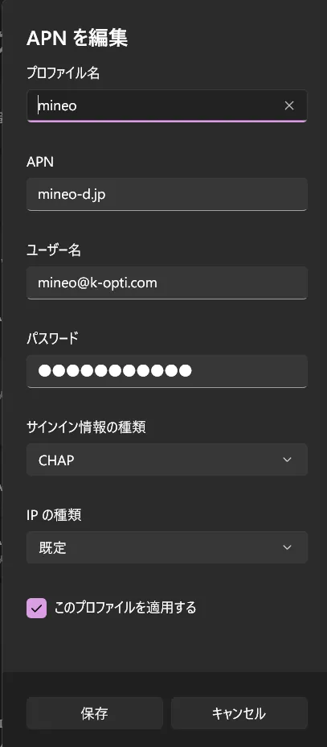
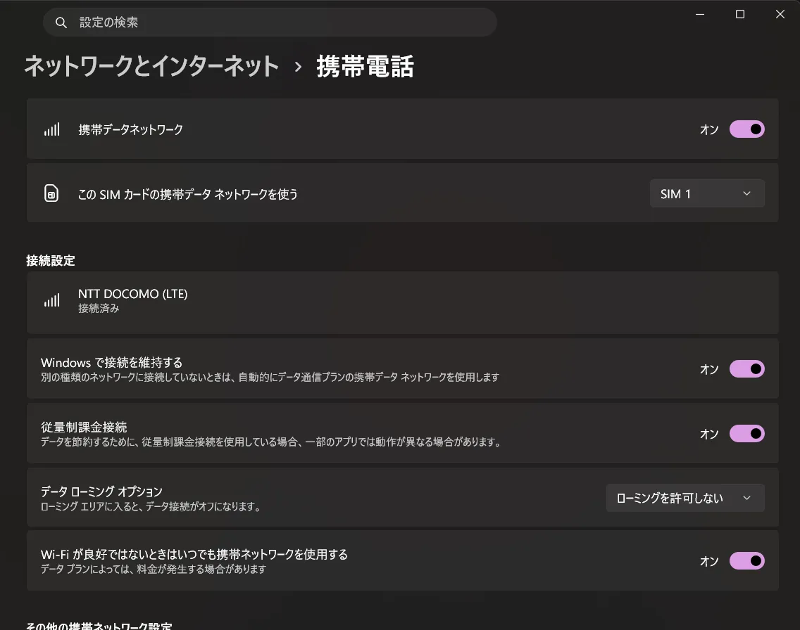
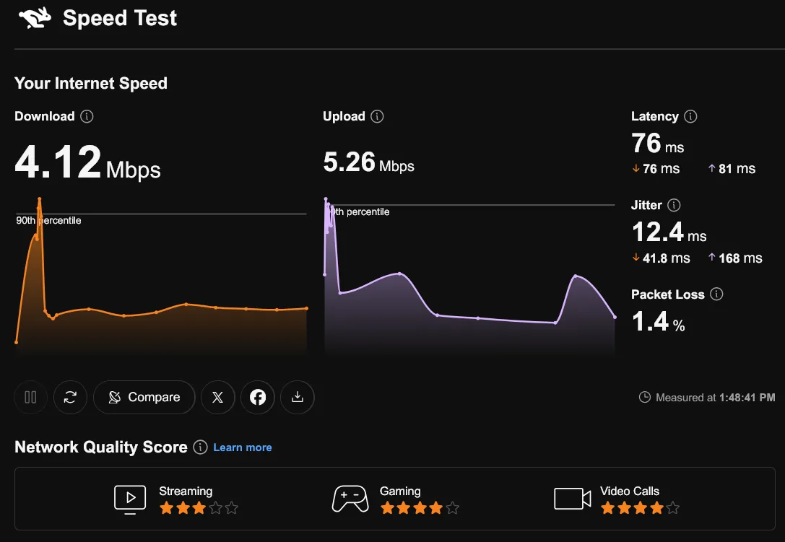

##  週報
グエーもう終末だよ  
もう12月やんね、どうすんねん  
最近、テストばっかで嫌になりますよー  
お勉強せんなん

そういえば、マイネオ申し込みました  
着弾したのでその話でも書こうかな

## 思うこと
マイネオ申し込んだんですよ  
今回はx13に入れて学内ネットが遅い時のサブ回線として使おうかなと思っております。  
マイピタ？がなんか11月末まで安かったんですが、ギガの管理が面倒なのでやめました

やっぱ無制限の方が気にすること減ってええやんね  
ということで、まいそくスタンダードにしました。

5Mbpsはいいかもしれないけど、あまり必要ないし高いかなって  
300Kbps, 32Kbpsは使い物にならないかなってなったので、1.5Mbpsになりました

プラン見てみたら、音声通話とデータ専用どっちも同じ金額なので、せっかくなら音声通話のやつにしました  
あと5Gオプションだけチェックしときました

あとは特にプラン入れてないかな、本当に最低限のプランのはず

で、後は普通に審査に投げるだけで終わりですね。  
したら登録した住所と本人確認書類の住所が違ってて怒られちゃいました  
アホですね、確認しておけばよかった

ままええです、通ったので

通ったのが確か水曜日、発送連絡が木曜深夜だったんですが金曜昼にはもう届いてました  
恐ろしい物流ですわ、HNDから来たのに早くておったまげ

とりあえず、RN12Turboで疎通確認

うん、普通に繋がりますね  
APN設定しなきゃ〜とか思ってたのにsim入れた瞬間繋がってワロタ

ということでsimをx13に挿し挿し

なんかアタッチ変更出来ねえんだけど  

claudeに言われるがままAPN設定を削除して作り直したら行けました。なんだったんだ

とりま速度測ってみる

まあ普通ですね、申し込んだ際に書かれてた通りの速度が出とります

使ってみた感じ、画像読み込みが遅いかなくらいであとは普通でした。  
misskey割と動いておったまげ  
twitterとかは厳しいかな？くらい。待てば表示されるので別に困りはしないかな。

マジでいい感じかも。ちょっとこれで様子見しますわ

最近、運営会社がお漏らししたのだけが非常に心配ですがまあサービス自体はいいんじゃないでしょうか

といったところですかね

うんちー。